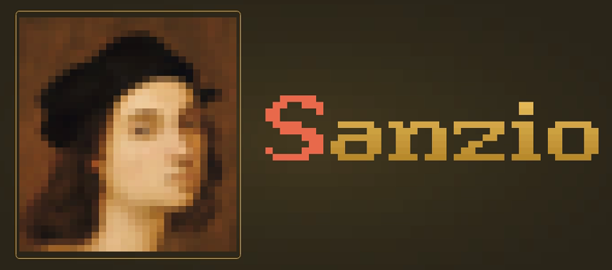
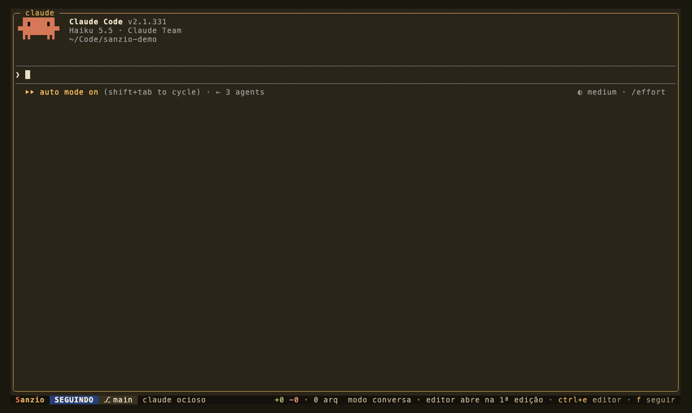
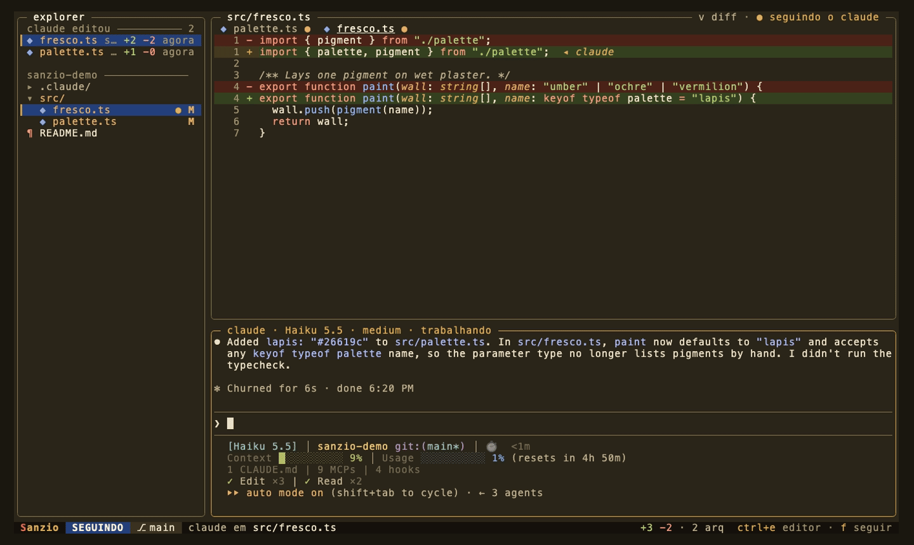

<p align="center">
  
</p>

<p align="center">
  <em>Watch the work as it is painted.</em><br>
  The real Claude Code in your terminal, with an editor that follows every stroke the agent makes.
</p>

<p align="center">
  <a href="https://www.npmjs.com/package/sanzio"></a>
  <a href="LICENSE"></a>
  
</p>

<p align="center">
  
</p>

---

Coding with an agent, the code drifts out of sight. You see the snippets it chooses to show, never the whole canvas. Sanzio puts the canvas back: type `sanzio` where you would type `claude`, and the moment Claude touches a file, it opens beside the conversation, in a diff, with the new lines marked `◂ claude`.

It is named after **Raffaello Sanzio**, whose _bottega_ was the largest of the Renaissance: one master, many hands, the work always in view.

## Install

```sh
npm i -g sanzio
sanzio
```

Or with Bun: `bun add -g sanzio`. Requires [Bun](https://bun.sh) 1.3.5+ and [Claude Code](https://code.claude.com).

Every argument goes straight to `claude`: `sanzio -c`, `sanzio --resume <id>`, `sanzio --model haiku`.

## The workshop

### The real Claude Code, untouched

Your `claude`, with your skills, plugins, hooks, MCP servers and statusline. Keys, paste, images and the mouse pass through. Sanzio adds what it needs for one session only (`--settings` and `--plugin-dir`) and never writes your configuration.

### Follow the agent

When Claude edits a file, with Edit, Write or a `sed` in Bash, the editor jumps to it and shows the diff. The explorer keeps a list of what Claude touched this session, newest first, with `+/−` and age.

- Click another file to pause following. Press `f` to resume.
- Paused, a new edit shows a notice: open it or ignore it.

<p align="center">
  
</p>

### Conversation mode

No edits yet, only Claude on screen, as if you had typed `claude`. The explorer and editor appear on the first edit. `ctrl+e` shows or hides them at any time.

### Retouch by hand

Press `i` in the editor (or double-click a line) to edit, `ctrl+s` to save, `ctrl+z` / `ctrl+y` to undo and redo, `v` to switch between diff, whole file and side by side. If Claude changes the file you are editing, nothing is lost: reload, keep yours, or look at its diff first.

## Two varnishes

<p align="center">
  
  &nbsp;
  
</p>

**verniz** (default) is the dark brown of a portrait's ground, with gold and lapis. **pergaminho** is parchment and sepia. Both reach Claude Code itself, through a theme that lives only in Sanzio sessions.

```sh
SANZIO_THEME=pergaminho sanzio
```

or `~/.config/sanzio/config.json`:

```json
{ "theme": "pergaminho" }
```

The environment variable wins over the file.

## Keys

| Key                 | Where            | What it does                                 |
| ------------------- | ---------------- | -------------------------------------------- |
| `ctrl+e`            | anywhere         | show or hide the explorer and editor         |
| `ctrl+o`            | anywhere         | move the focus: Claude, explorer, editor     |
| `f`                 | explorer, editor | resume following Claude                      |
| `i`                 | editor           | edit the open file                           |
| `ctrl+s`            | editing          | save                                         |
| `ctrl+z` / `ctrl+y` | editing          | undo / redo                                  |
| `esc`               | editing          | stop editing (asks if there is unsaved text) |
| `v`                 | editor           | diff, whole file, side by side               |

## From source

```sh
git clone https://github.com/GuilhermeJMoura/sanzio
cd sanzio
bun install
bun link
```

The GIFs are recorded with [VHS](https://github.com/charmbracelet/vhs) from the tapes in `docs/tapes/`.

## Credits

The portrait is Raphael's self-portrait (c. 1506, Galleria degli Uffizi), public domain, via Wikimedia Commons. Built on [OpenTUI](https://opentui.com) and Bun.

## License

MIT
